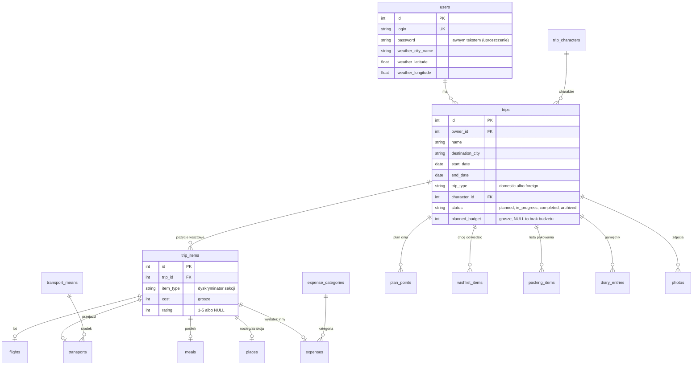

# Moje podróże

Webowa aplikacja do osobistego użytku: planer podróży, pamiętnik odwiedzonych miejsc i organizer
w trakcie wyjazdu. Projekt zaliczeniowy z przedmiotu „Testowanie aplikacji webowych”.

| Część | Stan | Technologia |
|---|---|---|
| Backend (API, logika, baza) + testy jednostkowe | **gotowy – etap 1** | Python 3.13, FastAPI, SQLAlchemy 2, Alembic, SQLite, pytest |
| Testy integracyjne backendu | późniejszy etap (faza 2) | pytest + TestClient, tymczasowa baza SQLite |
| Frontend (GUI) | do zrobienia (faza 3) | React + Vite, React Router, Pico CSS |
| Testy E2E | do zrobienia (faza 4) | Playwright (Python) |
| Jakość kodu | skonfigurowane | Ruff, **SonarQube (lokalnie, Docker)**, GitHub Actions |

**SonarQube jest podpięty do projektu:** backend ma gotową konfigurację analizy statycznej
(`backend/sonar-project.properties`) z raportami pokrycia testami, wyników testów i uwag Ruffa,
a serwer i skaner uruchamia się przez Docker Compose – instrukcja w sekcji
[SonarQube (lokalnie)](#sonarqube-lokalnie).

> **Uwaga o bezpieczeństwie:** logowanie jest celowo uproszczone (hasła zapisane w bazie jawnym
> tekstem, id użytkownika w nagłówku `X-User-Id`, który łatwo podmienić) – to projekt szkoleniowy
> uruchamiany wyłącznie na localhost, nie wolno go tak wdrażać.

Instrukcje dla agentów AI i plan kolejnych faz: [AGENTS.md](AGENTS.md).
Lista endpointów pod ekrany GUI: [docs/api.md](docs/api.md).
Wymagania i analiza funkcjonalności: [docs/wymagania/](docs/wymagania/).

---

## Szybki start (backend, bez Dockera)

Wymagany Python 3.13. Środowisko wirtualne (venv) leży w katalogu `.venv/` w głównym katalogu
repozytorium i nie trafia do gita – każdy tworzy je u siebie.

**Pierwsze uruchomienie** (PowerShell, z katalogu głównego repozytorium):

```powershell
python -m venv .venv                                                       # venv (jednorazowo)
.venv\Scripts\python.exe -m pip install -r backend\requirements-dev.txt   # biblioteki
```

**Uruchomienie serwera:**

```powershell
.venv\Scripts\Activate.ps1      # aktywacja venv (Linux/macOS: source .venv/bin/activate)
cd backend
uvicorn app.main:app --reload
```

> Gdy PowerShell zgłosi, że wykonywanie skryptów jest wyłączone, wykonaj raz
> `Set-ExecutionPolicy -Scope CurrentUser RemoteSigned` albo pomiń aktywację i wywołuj Pythona
> pełną ścieżką: `..\.venv\Scripts\python.exe -m uvicorn app.main:app --reload` (z katalogu `backend/`).
>
> **PyCharm:** *File → Settings → Project → Python Interpreter → Add Interpreter → Add Local
> Interpreter → Existing* i wskaż `.venv\Scripts\python.exe`. Terminal PyCharma aktywuje venv sam.
>
> Pozostałe polecenia w tym README (`pytest`, `ruff`, `alembic`) zakładają aktywny venv
> i katalog `backend/`.

Przy starcie aplikacja sama wykonuje migracje bazy (`alembic upgrade head`) i tworzy plik
`backend/data/moje_podroze.db` oraz katalog na zdjęcia `backend/data/uploads/`.

| Adres | Co to jest |
|---|---|
| http://localhost:8000/docs | **Swagger UI** – interaktywna dokumentacja API |
| http://localhost:8000/redoc | ReDoc – ta sama dokumentacja w wersji do czytania |
| http://localhost:8000/openapi.json | schemat OpenAPI 3 (np. do generowania klienta) |
| http://localhost:8000/api/health | sprawdzenie, czy API działa |

### Jak używać Swaggera

1. `POST /api/auth/register` → „Try it out” → login i hasło → zapamiętaj `id` z odpowiedzi.
2. Przycisk **Authorize** (kłódka) → wpisz to `id` w pole **X-User-Id** → Authorize.
3. Od tej chwili każde zapytanie wysyła nagłówek `X-User-Id` (Swagger zapamiętuje go po odświeżeniu).
4. `GET /api/dictionaries` zwraca id charakterów podróży, środków transportu i kategorii wydatków
   potrzebne w formularzach.

### Konfiguracja

Zmienne środowiskowe z prefiksem `MP_` (albo plik `backend/.env`, wzór w `backend/.env.example`):

| Zmienna | Domyślnie | Opis |
|---|---|---|
| `MP_DATABASE_URL` | `sqlite:///backend/data/moje_podroze.db` | adres bazy SQLAlchemy |
| `MP_UPLOAD_DIR` | `backend/data/uploads` | katalog na pliki zdjęć |
| `MP_MAX_UPLOAD_BYTES` | `10485760` (10 MB) | limit rozmiaru zdjęcia |
| `MP_AUTO_MIGRATE` | `true` | migracje przy starcie aplikacji |
| `MP_CORS_ORIGINS` | `["http://localhost:5173", "http://127.0.0.1:5173"]` | adresy frontendu (Vite) |
| `MP_EXTERNAL_API_TIMEOUT_SECONDS` | `5` | timeout zapytań do Open-Meteo i NBP |

---

## Uruchomienie w Dockerze

```bash
docker compose up -d --build       # backend na http://localhost:8000/docs
docker compose logs -f backend
docker compose down                # dane zostają w wolumenie backend-data
docker compose down -v             # usuń także bazę i zdjęcia
```

---

## Architektura backendu

```
backend/
├── app/
│   ├── main.py            # create_app(): FastAPI, Swagger, CORS, handlery błędów, migracje
│   ├── config.py          # ustawienia (pydantic-settings, prefiks MP_)
│   ├── domain/            # CZYSTA logika biznesowa – bez FastAPI i bazy (testy jedn. + mutacyjne)
│   │   ├── status.py      #   maszyna stanów podróży, archiwum tylko do odczytu
│   │   ├── items.py       #   polimorficzne pozycje: TripItem → Flight, Transport, Meal, Place, Expense
│   │   ├── trip_types.py  #   polityki typu podróży (krajowa/zagraniczna), lista pakowania
│   │   ├── costs.py       #   kosztorys, porównanie z budżetem, alert 90%/100%
│   │   ├── ratings.py     #   średnie ocen
│   │   ├── recommendations.py, stats.py, trips.py (odliczanie), currency.py, album.py
│   ├── db/                # SQLAlchemy: modele, typ Money (grosze), sesja, uruchamianie migracji
│   ├── schemas/           # Pydantic: walidacja wejścia i kształt odpowiedzi API
│   ├── services/          # logika aplikacyjna: baza + domena (reguły sprawdzane tutaj)
│   ├── integrations/      # klienci Open-Meteo i NBP (+ czyste funkcje parsujące)
│   ├── api/               # routery FastAPI (cienkie), zależności (X-User-Id), opisy błędów
│   └── core/              # błędy aplikacji i jednolity format odpowiedzi błędów
├── migrations/            # Alembic (schemat + dane słownikowe)
└── tests/
    └── unit/              # domena, parsery API, schematy, typ Money, zapis plików
                           # (tests/integration/ – w późniejszym etapie, patrz AGENTS.md)
```

Zasady:

* **Domena nie zależy od frameworków.** `app/domain` nie importuje FastAPI ani SQLAlchemy.
* **Polimorfizm pozycji.** Kosztorys, średnie i rekomendacje używają tylko interfejsu `TripItem`
  (`get_cost()`, `get_rating()`, `get_section()`, `is_allowed_for(typ)`). Nowy rodzaj pozycji to
  nowa klasa, bez zmian w kosztorysie.
* **Cienkie routery.** Reguły biznesowe (np. archiwum tylko do odczytu) sprawdzają serwisy.
* **Jednolity format błędów:** `{"detail": "komunikat po polsku", "code": "STAŁY_KOD"}`.
* **Kwoty** tylko w PLN, w API jako liczby z 2 miejscami po przecinku, w bazie jako grosze.
* **Wyniki obliczeń nie są zapisywane** (kosztorys, średnie, statystyki, rekomendacje liczone na bieżąco).

### Reguły biznesowe w skrócie

| Reguła | Gdzie | Błąd API |
|---|---|---|
| Status zmienia się o 1 krok: w planie ⇄ w trakcie ⇄ zrealizowana ⇄ archiwum | `domain/status.py` | 409 `INVALID_STATUS_TRANSITION` |
| Archiwum jest tylko do odczytu (każdy zapis) | `domain/status.py` | 409 `TRIP_ARCHIVED` |
| Loty tylko w podróży zagranicznej | `domain/items.py` | 409 `SECTION_NOT_ALLOWED` |
| Zmiana typu na krajową, gdy są loty → „usuń najpierw loty” | `domain/trip_types.py` | 409 `TRIP_TYPE_CHANGE_BLOCKED` |
| Podróż zagraniczna dostaje paszport, ubezpieczenie, przejściówkę na listę pakowania | `domain/trip_types.py` | – |
| Punkt planu dnia musi mieścić się w terminie podróży | `domain/common.py` | 422 `DATE_OUTSIDE_TRIP` |
| Alert budżetu: < 90% ok, 90–100% ostrzeżenie, > 100% przekroczony | `domain/costs.py` | – |
| Ocena zbiorcza = zwykła średnia ocen pozycji (bez wag), posiłek = ocena restauracji | `domain/ratings.py` | – |
| Cudza podróż wygląda jak nieistniejąca | `services/trips.py` | 404 `NOT_FOUND` |
| Brak / zły nagłówek `X-User-Id` | `api/deps.py` | 401 `AUTH_REQUIRED` / `INVALID_USER` |
| Zewnętrzne API nie odpowiada (reszta aplikacji działa) | `integrations/` | 503 `EXTERNAL_API_UNAVAILABLE` |

---

## Baza danych

SQLite (jeden plik) obsługiwany przez SQLAlchemy 2.x, schemat zarządzany migracjami **Alembic**.
Zdjęcia leżą na dysku (`MP_UPLOAD_DIR`), a w bazie jest tylko ich ścieżka względna.



| Tabela | Zawartość |
|---|---|
| `users` | login (unikalny), hasło, miasto widżetu pogody (domyślnie Warszawa) |
| `trips` | właściciel, nazwa, cel (miasto, kraj), daty, typ, charakter, status, budżet |
| `trip_items` | **wspólna część pozycji**: podróż, rodzaj (`item_type`), koszt, ocena |
| `flights` / `transports` / `meals` / `places` / `expenses` | pola specyficzne dla sekcji (dziedziczenie tabel złączonych) |
| `plan_points` | plan dnia: dzień, godzina, miejsce, opis |
| `wishlist_items` | „chcę odwiedzić” z flagą `visited` |
| `packing_items` | lista pakowania: `packed`, `is_default` (dodane automatycznie) |
| `diary_entries` | wpisy pamiętnika: data, tytuł, treść |
| `photos` | metadane zdjęcia: nazwa pliku na dysku, typ, rozmiar, dzień albumu, podpis |
| `trip_characters`, `transport_means`, `expense_categories` | słowniki (wypełniane w migracji) |

Decyzje projektowe:

* **Kwoty w groszach (`INTEGER`)** przez własny typ `Money` – SQLite nie ma typu dziesiętnego,
  a liczby zmiennoprzecinkowe gubią grosze. Dzięki temu `SUM()` w statystykach jest dokładne.
* **Dziedziczenie tabel złączonych** dla pozycji: suma kosztów to jedno zapytanie po `trip_items`,
  a ORM zwraca od razu właściwe klasy (`Flight`, `Meal`…), które mają `to_domain()`.
* **Ograniczenia w bazie** (CHECK: daty, budżet > 0, koszt ≥ 0, ocena 1–5; klucze obce z
  `ON DELETE CASCADE`, włączone `PRAGMA foreign_keys`) jako druga linia obrony po walidacji Pydantic.
* Usunięcie podróży usuwa jej pozycje, plan, listy, pamiętnik, zdjęcia i **pliki zdjęć z dysku**.

Migracje (z katalogu `backend/`):

```bash
alembic upgrade head                                   # zastosuj migracje (robi to też start aplikacji)
alembic revision --autogenerate -m "opis zmiany"       # po zmianie modeli w app/db/models.py
alembic downgrade -1                                   # cofnij ostatnią migrację
```

Reset lokalnej bazy: zatrzymaj aplikację i usuń katalog `backend/data/`.
Zgodność migracji z modelami: `alembic upgrade head && alembic check` (oczekiwane „No new upgrade
operations detected”). W fazie testów integracyjnych dojdzie automatyczny test.

---

## Testy

```bash
cd backend
pytest                       # wszystkie testy (obecnie 274 jednostkowe, ~3 s)
pytest -m unit               # tylko jednostkowe – bez bazy i sieci
pytest --cov                 # z raportem pokrycia (moduł domenowy: 100%, całość: ~64%)
pytest --cov --cov-report=html   # raport HTML w backend/htmlcov/
```

| Poziom | Gdzie | Co sprawdza |
|---|---|---|
| Jednostkowe | `tests/unit/domain` | maszyna stanów (kroki do przodu/wstecz, zabronione przeskoki), archiwum, reguły sekcji dla typu, kosztorys, progi budżetu 89/90/100/101%, średnie ocen, ranking rekomendacji, odliczanie z „zamrożoną” datą, statystyki, kalkulator walut |
| Jednostkowe | `tests/unit/integrations` | parsowanie odpowiedzi Open-Meteo i NBP, obsługa błędów, klient HTTP z `httpx.MockTransport` |
| Jednostkowe | `tests/unit/infrastructure` | typ `Money`, rozpoznawanie formatu zdjęcia, zapis plików, walidacja schematów |
| Integracyjne | `tests/integration` (**późniejszy etap**) | endpointy na prawdziwej bazie SQLite (świeża kopia dla każdego testu, schemat z migracji), izolacja danych użytkowników, upload zdjęć, archiwum, atrapy API pogody i NBP (także ich awaria), migracje, Swagger |
| Mutacyjne | `mutmut` na `app/domain` | jakość testów jednostkowych domeny (patrz niżej) |

Testy integracyjne są zaplanowane na późniejszy etap (decyzja 8 w
`docs/wymagania/opis-aplikacji-i-funkcjonalnosci.md`, plan w `AGENTS.md`, faza 2). Do tego czasu
próg pokrycia w `backend/pyproject.toml` wynosi 60% (API, serwisy i warstwa bazy nie mają jeszcze
testów automatycznych); po ich dodaniu wraca do 90%.

### Testy mutacyjne (mutmut)

mutmut 3.x działa tylko na Linuksie/macOS. Na Windows użyj Dockera, WSL albo GitHub Actions:

```bash
docker compose run --rm backend-dev mutmut run       # w kontenerze (Linux)
docker compose run --rm backend-dev mutmut results   # lista mutantów, które przeżyły
docker compose run --rm backend-dev mutmut show <nazwa_mutanta>
```

Konfiguracja w `backend/pyproject.toml` (`[tool.mutmut]`): mutowany jest tylko `app/domain/`,
a uruchamiane są testy z `tests/unit/domain`. W GitHub Actions: zakładka *Actions* → *Backend* →
*Run workflow* → zaznacz „Uruchom testy mutacyjne”.

---

## Jakość kodu

```bash
cd backend
ruff check .            # lint (pycodestyle, pyflakes, bugbear, bandit, reguły FastAPI…)
ruff format .           # formatowanie
```

GitHub Actions (`.github/workflows/backend.yml`) uruchamia Ruff i testy przy każdym pushu.

### SonarQube (lokalnie)

Statyczna analiza kodu w lokalnym SonarQube (Community Edition), bez konta w chmurze.

**Co jest skonfigurowane:**

| Element | Plik | Opis |
|---|---|---|
| Projekt Sonara | `backend/sonar-project.properties` | klucz `moje-podroze-backend`, źródła `app/` i `migrations/`, testy `tests/`, Python 3.13 |
| Pokrycie testami | `backend/coverage.xml` | raport z `pytest --cov` |
| Wyniki testów | `backend/test-results.xml` | raport JUnit z pytest |
| Uwagi lintera | `backend/ruff-report.json` | raport Ruffa importowany do Sonara |
| Wykluczenia | `backend/sonar-project.properties` | migracje bez wymagań pokrycia i bez wykrywania duplikatów |
| Serwer SonarQube | `docker-compose.yml` → `sonarqube` (profil `sonar`) | http://localhost:9000, dane w wolumenach Dockera |
| Skaner | `docker-compose.yml` → `sonar-scanner-backend` (profil `sonar-scan`) | analizuje katalog `backend/`, token z `SONAR_TOKEN` |

Frontend dostanie w kolejnej fazie własny projekt Sonara (`moje-podroze-frontend`).

**Wymagania:** Docker Desktop (na Windows z WSL 2) i ok. 4 GB RAM dla kontenera SonarQube.
Kroki 2–3 wykonuje się tylko raz.

1. Uruchom serwer: `docker compose --profile sonar up -d` i poczekaj ok. 1–2 min.
2. Otwórz http://localhost:9000, zaloguj się `admin` / `admin` i ustaw nowe hasło.
3. *My Account → Security → Generate Token* (typ „Global Analysis Token”), skopiuj token.
4. Wygeneruj raporty dla Sonara:
   ```bash
   cd backend
   pytest --cov --cov-report=xml --junitxml=test-results.xml
   ruff check . --output-format=json --exit-zero -o ruff-report.json
   ```
5. Uruchom skaner (z katalogu głównego repozytorium):
   ```powershell
   $env:SONAR_TOKEN="<token>"; docker compose run --rm sonar-scanner-backend    # PowerShell
   SONAR_TOKEN=<token> docker compose run --rm sonar-scanner-backend            # bash
   ```
6. Wyniki: http://localhost:9000/dashboard?id=moje-podroze-backend

Zatrzymanie: `docker compose --profile sonar down` (dane Sonara zostają w wolumenach).

Wśród *Security Hotspots* może pojawić się hasło zapisane jawnym tekstem – to świadome
uproszczenie projektu (patrz uwaga o bezpieczeństwie na początku), można je oznaczyć jako *Safe*
z komentarzem.

Bez serwera: wtyczka **SonarQube for IDE** (dawniej SonarLint) w PyCharm pokazuje uwagi Sonara
na bieżąco w edytorze (bez pokrycia testami i bez dashboardu).

---

## Zewnętrzne API

| API | Użycie | Klucz |
|---|---|---|
| [Open-Meteo](https://open-meteo.com/) – forecast | bieżąca pogoda w widżecie | nie |
| [Open-Meteo](https://open-meteo.com/en/docs/geocoding-api) – geocoding | wyszukiwanie miasta w widżecie | nie |
| [NBP](https://api.nbp.pl/) – tabela A | kursy EUR, USD, GBP i kalkulator walut | nie |

Gdy API nie odpowiada, endpoint zwraca `503 EXTERNAL_API_UNAVAILABLE`, a pozostałe endpointy
działają normalnie (GUI pokazuje komunikat tylko w danym widżecie).
